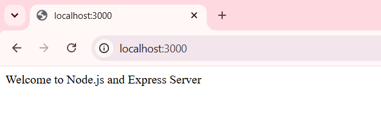
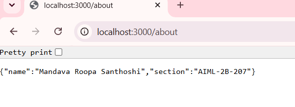
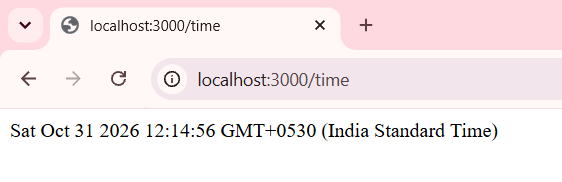
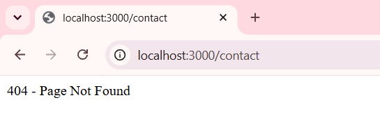

# Lab 01 – HTTP Server and Express Server

## Student Details

- **Name:** Mandava Roopa Santhoshi
- **Registration Number:** 252U1R6111
- **Section:** AIML-2B-207
- **Course:** Backend Development Fundamentals

## Live Deployment URL

**Render URL:** https://lab-submission-1-backend.onrender.com

**Deployment Status:** Successfully deployed.

## 1. Objective

The main aim of this lab is to learn how a web server works using Node.js and Express.js. Through this practical, I learned to create a basic HTTP server, define different routes, send responses to client requests, display dynamic date and time, and manage requests for unavailable pages using a 404 status code.

## 2. Technologies Used

- Node.js
- Express.js
- JavaScript
- Git and GitHub
- Render

## 3. Project Structure

```text
lab-01/
│
├── screenshots/
│   ├── home.png
│   ├── about.png
│   ├── time.png
│   ├── not-found.png
│   ├── home status.png
│   ├── about status.png
│   ├── time status.png
│   └── not-found status.png
│
├── .gitignore
├── http-server.js
├── package.json
├── package-lock.json
├── server.js
└── README.md
```

## 4. Installation and Execution

### Prerequisites

- Node.js installed
- npm installed

### Installation

```bash
npm install
```

### Run the HTTP server

```bash
node http-server.js
```

### Run the Express server

```bash
node server.js
```

### Environment Variables

The server uses the following environment variable:

| Variable | Description | Default |
|---|---|---|
| PORT | Port on which the server runs | 3000 |

No additional environment variables are required.

## 5. API Endpoints

**Base URL:** https://lab-submission-1-backend.onrender.com

| Method | Endpoint | Description | Status Code |
|---|---|---|---|
| GET | `/` | Displays the welcome message. | 200 OK |
| GET | `/about` | Returns student name and section in JSON format. | 200 OK |
| GET | `/time` | Returns the current date and time. | 200 OK |
| GET | `/contact` | Demonstrates the 404 response for an invalid route. | 404 Not Found |

## 6. Screenshots of Working Output

### Home Endpoint

Displays the welcome message.



### About Endpoint

Displays student details in JSON format.



### Time Endpoint

Displays the current date and time.



### 404 Error Endpoint

Displays the page not found message for an invalid route.



## 7. Status Code Screenshots

### Home Endpoint – 200 OK


### About Endpoint – 200 OK


### Time Endpoint – 200 OK


### Invalid Route – 404 Not Found


## 8. Deployment

The Express server was successfully deployed using Render.

**Live URL:** https://lab-submission-1-backend.onrender.com

All four endpoints were tested using the deployed public URL, and their responses and status codes were verified.

## 9. Conclusion

This lab helped me understand the basic working of backend servers through practical implementation. I gained experience in creating servers using both the Node.js HTTP module and Express.js. I also learned how different routes respond to client requests, how to return JSON data, and how to handle invalid URLs. Finally, deploying the application on Render gave me an understanding of making a locally developed server accessible online.